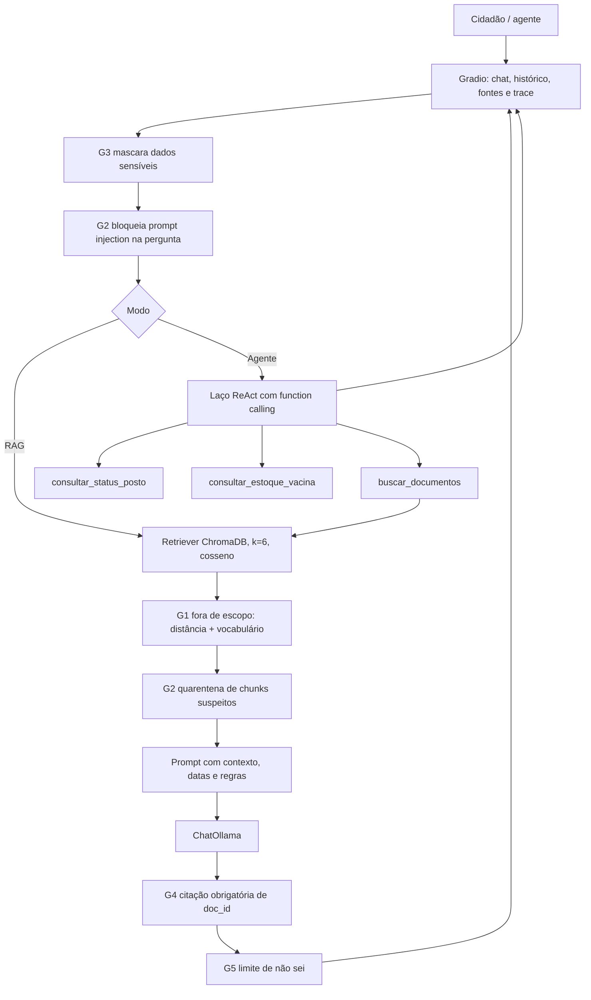

# CitizenTech — Assistente de vacinação do Centro de Operações do Município (COB)

**GS 2026/2 · Turma:** 1CCPG] · **Grupo:** CitizenTech
**Frente:** Serviço público essencial — vacinação nos postos de saúde (UBS)

| Integrante | RM |
|---|---|
| Lana Namie Kano Ozeki | 569795 |
| Luan de Araujo Carneiro | 573691 |
| Pedro Ribeiro Lopes | 570083 |

---

## 1. Descrição

O **CitizenTech** responde dúvidas de cidadãos (e de agentes públicos) sobre vacinação a partir de uma **base documental municipal**, de forma **ancorada** (só usa os documentos), **rastreável** (cita o `doc_id` e mostra os trechos usados) e **avaliada** (RAGAS). Para o que o LLM não sabe sozinho (a UBS está aberta nesta data e hora? há dose em estoque?), um **agente** chama ferramentas.

**Cenário (fictício, para fins acadêmicos):** Mobilização Estadual (mutirão) contra o **sarampo** e a **febre amarela**, de **2 a 8 de fevereiro de 2026**, com **Dia D** no sábado 7 e domingo 8. UBS participantes: **Vila Santa Catarina** (Zona Sul), **Salvador de Leone** (Itapecerica da Serra) e **Vila Gumercindo** (Zona Sul). As UBS ficam fechadas em 17/02 (Carnaval) e 18/02 (Quarta-feira de Cinzas).

**Pergunta típica:** *"Posso tomar a vacina contra o sarampo na UBS Vila Gumercindo hoje, depois das 17h? Preciso de documento?"*

> Atenção: nomes de UBS, horários, estoques e regras de saúde da base são **ilustrativos**. Este projeto **não** deve ser usado como orientação de saúde real.

## 2. Base documental (`2_base_documental/`)

| Arquivo | doc_id | Tipo | Publicação | Conteúdo |
|---|---|---|---|---|
| `doc_01_protocolo_vacinacao.txt` | doc_01 | protocolo | 2025-03-10 | horário padrão, documentos, menores de 18 anos, vacinas |
| `doc_03_nota_tecnica_publico_alvo.txt` | doc_03 | nota técnica | 2025-12-10 | público-alvo, gestantes, documento digital, adolescentes de 16–17 anos |
| `doc_02_comunicado_agenda.txt` | doc_02 | comunicado | 2026-01-20 | mobilização, horários por UBS, Dia D, feriados, documentos esquecidos |

**Armadilhas propositais:** os documentos se contradizem e **vale o mais recente** (documento com foto × documento digital × "ninguém deixa de ser vacinado"; acompanhante até 18 anos × 16–17 anos sem acompanhante); o horário muda entre dias úteis e Dia D; e o horário padrão não vale em feriado (Carnaval).

## 3. Pipeline



Versão em texto:

```
Pergunta -> mascara PII (G3) -> checa injeção (G2) -> [RAG] busca no Chroma (k=6)
         -> fora de escopo? (G1) -> quarentena de chunks (G2) -> prompt + LLM
         -> exige/valida citação (G4) -> limite de "não sei" (G5) -> resposta + fontes
         -> [Agente] LLM decide a tool -> observação -> ... -> resposta final
```

## 4. Estrutura do notebook (`1_Notebook_GS2026_2.ipynb`)

| Seção | O que faz |
|---|---|
| 0. Metadados | integrantes, divisão de tarefas, declaração de IA, modelos; configuração do ambiente |
| 1. Base documental e chunking | carrega documentos com metadados; compara 4 estratégias de chunking |
| 2. Embeddings e índice ChromaDB | embeddings, coleção com `doc_id` e `data_publicacao`, busca com distância |
| 3. Pipeline RAG com contexto | cadeia LCEL com citação de `doc_id` e resposta "não sei" |
| 4. Agente com ferramentas | 3 tools e laço ReAct com trace (thought → action → observation) |
| 5. Interface Gradio | chat com histórico, modo RAG/Agente e painel de fontes |
| 6. Segurança e guardrails | 5 guardrails demonstrados |
| 7. Avaliação com RAGAS | 8 perguntas (4 simples, 4 armadilhas) e exportação do JSON |
| 8. Conclusão | resultados, erros do RAG e requisitos para produção |

## 5. Decisões de projeto

**Chunking.** Comparamos 4 estratégias com 8 perguntas de teste (o trecho esperado precisa aparecer nos 3 chunks mais próximos):

| Estratégia | Chunks | acerto@1 | acerto@3 |
|---|---|---|---|
| A: 500, sem sobreposição | 17 | 5/8 | 7/8 |
| **B: 500, sobreposição 100** | 17 | 5/8 | 7/8 |
| C: 1000, sem sobreposição | 7 | 4/8 | 7/8 |
| D: 1000, sobreposição 200 | 7 | 4/8 | 7/8 |

Escolhemos a **B (500/100)**: empatou no acerto@3 e teve acerto@1 maior que as de 1000 caracteres; a sobreposição evita cortar frases-chave na fronteira dos chunks. [Atualize esta tabela se mudar os documentos ou o teste.]

**Índice.** ChromaDB persistente, distância **cosseno**, metadados `doc_id`, `data_publicacao`, `tipo`, `chunk_id`; **k = 6** (com k menor, trechos como feriados e documentos esquecidos ficavam de fora e o modelo respondia "não sei").

**Modelos.** LLM `llama3.1:8b` e embeddings `nomic-embed-text`, via Ollama (`temperature=0`, `num_ctx=4096` iguais para LLM e juiz, para o Ollama não recarregar o modelo). O notebook tenta o **Ollama Cloud** quando existe o segredo `OLLAMA_API_KEY`; sem ele (ou sem cota, HTTP 402) usa o Ollama **local**. [Informe aqui qual modo rodou na versão entregue.]

**Prompt.** Responde só com o contexto, cita `[doc_id]`, aplica "vale o documento mais recente", usa um calendário injetado (o LLM erra dia da semana) e responde "Não sei…" quando o contexto não cobre a pergunta.

**Agente.** Laço ReAct com function calling e 3 tools: `consultar_status_posto(posto, data, hora)`, `consultar_estoque_vacina(posto, vacina)` e `buscar_documentos(pergunta)`. A data de "hoje" é fixa (06/02/2026) para os resultados serem reproduzíveis.

**Guardrails.**

| # | Guardrail | Como funciona |
|---|---|---|
| G1 | Fora de escopo | bloqueia se o melhor chunk passa do limiar de distância calibrado **e** a pergunta não tem vocabulário do domínio |
| G2 | Prompt injection | padrões na pergunta e quarentena de chunks adulterados |
| G3 | Dados sensíveis | mascara CPF, Cartão SUS, telefone e e-mail antes do LLM e dos logs |
| G4 | Citação obrigatória | anexa as fontes se faltar citação e remove `doc_id` inexistente |
| G5 | Limite de "não sei" | dois seguidos escalam para o atendimento presencial |

[Se incluir a seção 6.1 de testes automatizados, descreva aqui: quantos testes e o que cobrem.]

## 6. Avaliação (RAGAS) — `3_avaliacao_ragas.json`

8 perguntas (4 simples e 4 armadilhas) com *ground truth* escrito pelo grupo. Métricas: `faithfulness`, `answer_relevancy`, `context_precision` e `context_recall` (juiz: mesmo modelo que responde).

| Métrica | Média geral | Simples | Armadilhas |
|---|---|---|---|
| faithfulness | [preencher] | [preencher] | [preencher] |
| answer_relevancy | [preencher] | [preencher] | [preencher] |
| context_precision | [preencher] | [preencher] | [preencher] |
| context_recall | [preencher] | [preencher] | [preencher] |

**Leitura dos resultados:** [PREENCHER com 3–4 linhas: onde o RAG acerta, onde erra (qual pergunta, por quê) e os limites da medição: apenas 8 perguntas e juiz do mesmo modelo.]

## 7. Prints

Capture na execução final e referencie aqui (ajuste os caminhos/links):

| # | Print | Seção |
|---|---|---|
| 1 | Tabela de metadados | 0 |
| 2 | Comparação de chunking | 1 |
| 3 | Coleção Chroma e busca com `distance` | 2 |
| 4 | 3 perguntas com fonte e o "não sei" | 3 |
| 5 | Trace do agente (thought → action → observation) | 4 |
| 6 | Interface Gradio com histórico e fontes | 5 |
| 7 | Demonstração de G1–G5 | 6 |
| 8 | Tabela de métricas e JSON do RAGAS | 7 |

`` ... [PREENCHER]

## 8. Como executar

1. Abra `1_Notebook_GS2026_2.ipynb` no **Google Colab** e escolha **GPU (T4)** em *Ambiente de execução → Alterar tipo*.
2. (Opcional, Ollama Cloud) crie o segredo **`OLLAMA_API_KEY`** em *Secrets* (🔑) e ative *Acesso ao notebook*. A chave nunca é escrita no código. Sem ela, o notebook usa o Ollama local.
3. Rode **Ambiente de execução → Reiniciar e executar tudo**. O notebook instala as dependências, sobe o Ollama, baixa os modelos que faltarem, cria os documentos em `2_base_documental/` e exporta `3_avaliacao_ragas.json`.
4. Tempo aproximado: [PREENCHER após a execução]. O RAGAS é a etapa mais lenta.
5. A interface Gradio abre num link (local ou público temporário) e é encerrada na última célula.

## 9. Limitações e o que falta para produção

- **Dados reais:** ingestão automática de portarias e comunicados, com vigência (início/fim) em vez de só a data de publicação.
- **LGPD:** vacinação é dado sensível de saúde: minimizar e mascarar dados, não registrar o texto bruto, definir base legal, retenção e encarregado (DPO).
- **Infraestrutura:** LLM em GPU dedicada, Chroma em modo servidor ou pgvector, cache, observabilidade e avaliação contínua com mais de 50 perguntas.
- **Qualidade:** documentos conflitantes e cálculo de calendário ainda são pontos fracos; o juiz do RAGAS é o mesmo modelo que responde.
- **Segurança:** fallback para atendimento humano e revisão por profissional de saúde antes de qualquer uso real.

## 10. Uso de IA

Declarado no notebook (seção 0) e detalhado em `6_Chat_Log.txt`.
